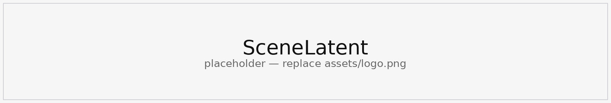
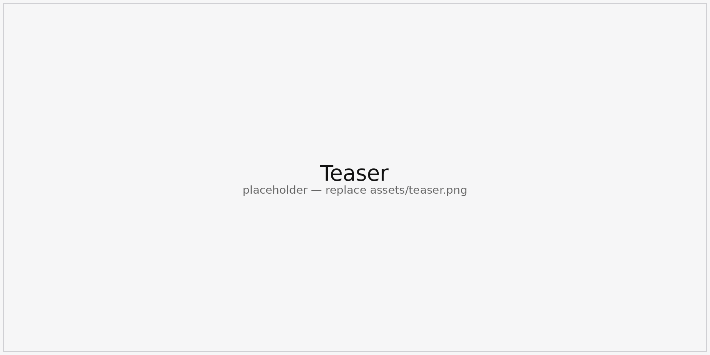
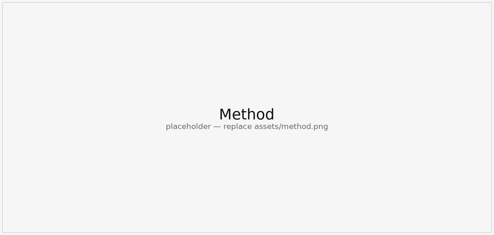
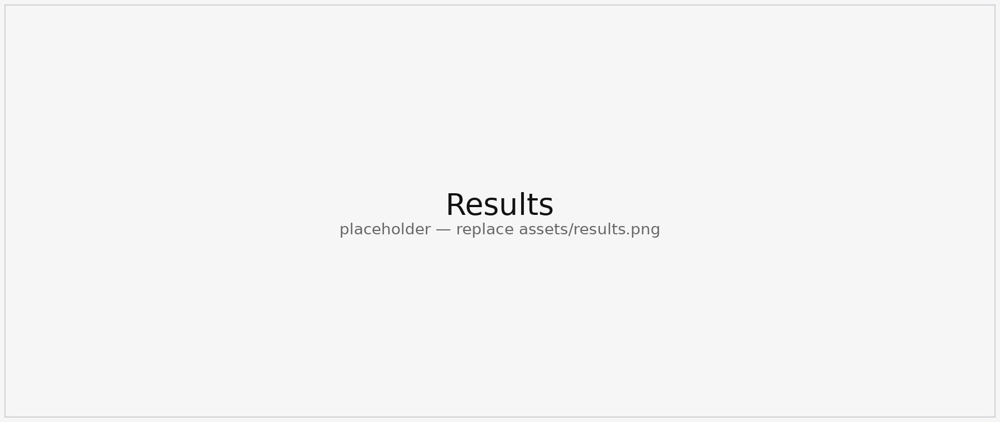

<div align="center">
  

  <h1>SceneLatent</h1>

  <p align="center">
    <a href="#">
      
    </a>
    <a href="#">
      
    </a>
    <a href="#">
      
    </a>
  </p>

  <p>
    Author list
  </p>

  <p>
    <sup>1</sup>Affiliation
  </p>
</div>

<p align="center">
  
</p>

<p align="center">
  <b>SceneLatent stores a scene as a sparse set of view-independent 3D latents.</b><br />
  Each latent is an explicit point with a 64-d code. A grid decoder renders new cameras, and two DiTs generate the points and their content.
</p>

## Highlights

<table>
  <tr>
    <td align="center"><b>Sparse 3D Latent</b><br />3,000 points, each an xyz anchor plus a 64-d code, instead of a dense feature volume.</td>
    <td align="center"><b>View-Independent</b><br />The same latent renders novel cameras. The scene is not re-encoded from pixels at every view.</td>
  </tr>
  <tr>
    <td align="center"><b>Geometry, then Content</b><br />Stage-1 denoises point positions. Stage-2 denoises latent content on those positions.</td>
    <td align="center"><b>Gated Refinement</b><br />The last sampling steps apply a per-point position correction scaled by (1 − s).</td>
  </tr>
</table>

## Method

<p align="center">
  
</p>

<p align="center">
  The encoder pools Depth Anything 3 features onto superpoint queries and writes the sparse latent. The grid decoder splats it into RGB and a residual inverse depth. Generation uses two flow-matching DiTs: stage-1 predicts positions from the observed frame, and stage-2 predicts content, with a detached confidence gate for a small position update.
</p>

## Results

<p align="center">
  
</p>

<table align="center">
  <tr>
    <td align="center"><h3>—</h3>novel-view quality</td>
    <td align="center"><h3>—</h3>camera control</td>
    <td align="center"><h3>—</h3>geometric consistency</td>
  </tr>
</table>

## Installation

```bash
pip install -r requirements.txt
pip install -e third_party/pointrope
```

FRNN is compiled from `third_party/superpoint_transformer/src/dependencies/FRNN`. Deformable attention needs the MMCV CUDA op `ms_deform_attn_forward`.

Weights are not in this repository. Point the configs at a local Depth Anything 3 checkpoint (`DA3-BASE`, and `DA3-LARGE` for ScanNet chunks) and a DINOv3 ViT-L checkpoint.

## Data Processing

Preprocessing has two stages. Geometry scripts turn RGB video, poses, and depth into superpoint chunks. Generation scripts then pack a first-frame condition (`first_*`) and a scene target (`rest_*`). Run them from `process/`.

```bash
python make_superpoint_chunk_da3depth_geometry_dl3dv.py
python make_superpoint_chunk_da3depth_geometry_re10k.py
python make_superpoint_chunk_da3depth_geometry_scannet.py
python make_gen_chunk_dl3dv.py
python make_gen_chunk_re10k.py
python make_gen_chunk_scannet_v2.py
```

`make_superpoint_chunk_da3depth_geometry_dl3dv_eval.py` builds the DL3DV evaluation chunks. Two-view training also needs the last frame:

```bash
python add_last_frame_superpoints.py
```

Dataset roots in `vae/config.py` and `dit/configs/` are local paths. Edit them before training.

## For training

The VAE trains the superpoint encoder and the grid decoder together. Depth Anything 3 stays frozen. `init_from` in `vae/config.py` loads the pretrained encoder.

```bash
cd vae
torchrun --nproc_per_node=8 train.py --py-config config.py --work-dir /path/to/vae_out
python cache_latent.py --config cache_latent.json
```

`cache_latent.py` writes the `z_sp` sidecars used by the DiTs. The VAE training step itself re-encodes each batch and does not train on those sidecars.

Stage-1 learns positions. Stage-2 learns content on the stage-1 positions, after a Hungarian match binds each predicted slot to a ground-truth point.

```bash
cd dit
python tools/compute_canonical_stats.py configs/stage1.py
torchrun --nproc_per_node=8 train_stage1.py --config configs/stage1.py
torchrun --nproc_per_node=8 tools/cache_stage1_xyz.py
python tools/build_hungarian.py --dataset_config configs/stage2.py
torchrun --nproc_per_node=8 train_stage2.py --config configs/stage2.py
```

Two-view conditioning uses the first and last frames:

```bash
torchrun --nproc_per_node=8 train_stage1_2view.py --config configs/stage1_2view.py
torchrun --nproc_per_node=8 tools/cache_stage1_xyz_2view.py
python tools/build_hungarian.py --dataset_config configs/stage2_2view.py
torchrun --nproc_per_node=8 train_stage2_2view.py --config configs/stage2_2view.py
```

## For inference

`dit/sample.py` samples positions, then content. The last `refine_steps` of stage-2 also integrate a gated position velocity.

```python
from sample import sample_stage1_xyz, sample_stage2

xyz, mask = sample_stage1_xyz(
    stage1,
    batch,
    n_points=3000,
    steps=50,
    seed=0,
    source_noise=0.5,
    guidance=1.0,
    guidance_mode="camera",
)
out = sample_stage2(
    stage2,
    batch,
    xyz,
    mask,
    steps=50,
    seed=0,
    guidance_cond=1.5,
    refine_steps=10,
)
```

Run this from `dit/` after both checkpoints are loaded. `batch` is one sample from `dataset/first_frame.py` or `dataset/first_last.py`.

## Acknowledgements

This repository uses [Depth Anything 3](https://github.com/ByteDance-Seed/Depth-Anything-3), [DINOv3](https://github.com/facebookresearch/dinov3), [Superpoint Transformer](https://github.com/drprojects/superpoint_transformer), [PointRoPE](https://github.com/Pointcept/Pointcept), and [MMCV](https://github.com/open-mmlab/mmcv).

## Citation

```bibtex
@inproceedings{scenelatent,
  title     = {SceneLatent},
  author    = {},
  booktitle = {},
  year      = {}
}
```
