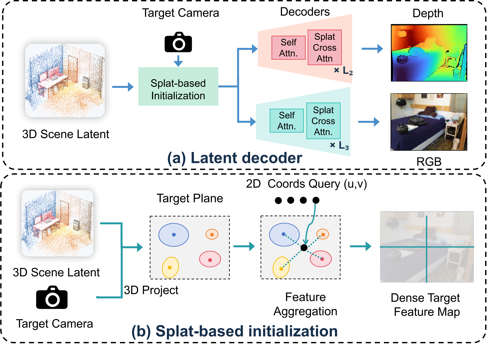
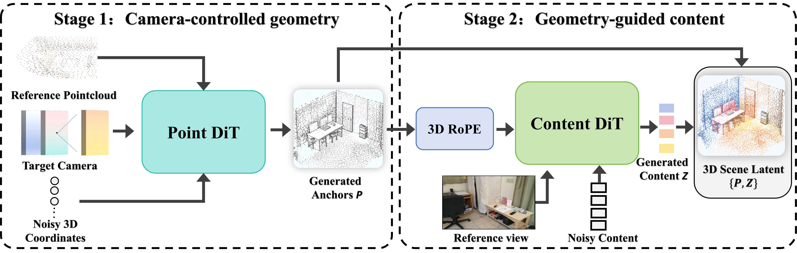

<div align="center">
 
  <h1>SceneAE: Scene Generation and Reconstruction in Queryable 3D-Anchored Latent Space</h1>

  <p align="center">
    <a href="https://arxiv.org/abs/2610.19708">
      
    </a>
    <a href="https://github.com/sunshuofeng/SceneAE">
      
    </a>
  </p>

  <p>
    Shuofeng Sun<sup>1</sup>, Wenzhao Zheng<sup>2</sup>, Yunpeng Zhang<sup>3</sup>, Yi Wu<sup>4</sup>, Linqing Zhao<sup>1</sup>, Haibin Yan<sup>1,†</sup>
  </p>

  <p>
    <sup>1</sup>Beijing University of Posts and Telecommunications &nbsp;&nbsp;
    <sup>2</sup>University of California, Berkeley<br>
    <sup>3</sup>PhiGent Robotics &nbsp;&nbsp;
    <sup>4</sup>SynapX
  </p>

  <p>
    <sup>†</sup>Corresponding author
  </p>
</div>

<p align="center">
  
</p>

<p align="center">
  <b>SceneAE stores a scene as a sparse, queryable 3D-anchored latent point cloud.</b><br />
  Each latent is an explicit 3D position plus a content feature for its local region. The same latent renders RGB-D for any discrete camera, and a geometry-content DiT generates it.
</p>

Video generation models produce an observation of a world, not a representation of the world itself. For one scene they can only roll out a continuous camera trajectory. A viewpoint off that trajectory cannot be queried, and another rollout of the same scene may disagree in geometry and may not describe the same world.

[Atlas](https://www.worldlabs.ai/blog/atlas) builds a spatial context from images, camera poses, and depth, then renders an observation at any discrete camera in that world. Reconstruction and generation read the same context.

SceneAE takes a simpler route. Each latent is bound to one explicit 3D position, so the model reads a 3D spatial context directly. After the scene latent is generated, any discrete camera inside the visible region is projected and decoded into RGB-D. No new video is generated for each trajectory. That is the same reconstruction-and-generation loop: observed regions stay on their anchors, and a new camera is only a query.

## Highlights

<table>
  <tr>
    <td align="center"><b>3D-Anchored Latent</b><br />3,000 points. Each point is an explicit position plus a 64-d content feature for one local region of the scene.</td>
    <td align="center"><b>Queryable RGB-D</b><br />One latent renders any discrete camera in the visible region. A new trajectory does not require a new video.</td>
  </tr>
  <tr>
    <td align="center"><b>Geometry, then Content</b><br />The camera trajectory first generates the 3D layout. Content is then synthesized on those positions with 3D RoPE.</td>
    <td align="center"><b>Gated Position Update</b><br />The last content-sampling steps apply a per-point position correction scaled by (1 − s).</td>
  </tr>
</table>

## Method

### Latent decoder

<p align="center">
  
</p>

<p align="center">
For the encoded or generated 3D latent data, by using a camera with any given viewpoint, the RGBD is rendered in a way of projecting query decoding, achieving efficient scene reconstruction and roaming.
</p>

### Geometry-content DiT

<p align="center">
  
</p>

<p align="center">
The DiT algorithm generates latent variables in two stages, thus keeping the geometric information and the content information separate. The first stage reads the observed frames and the target camera trajectory, and only predicts the three-dimensional position; the second stage writes the content features at each position. Therefore, the geometric transformation of the camera is only used for position generation, avoiding entanglement with appearance, thereby achieving more precise control. Additionally, content features of the anchored spatial positions are generated to enhance geometric consistency.
</p>

## Results

<p align="center">
  
</p>

## Installation

```bash
pip install -r requirements.txt
pip install -e third_party/pointrope
```

FRNN is compiled from `third_party/superpoint_transformer/src/dependencies/FRNN`. Deformable attention needs the MMCV CUDA op `ms_deform_attn_forward`.

Weights are not in this repository. Point the configs at a local Depth Anything 3 checkpoint (`DA3-BASE`, and `DA3-LARGE` for ScanNet chunks) and a DINOv3 ViT-L checkpoint.

## Data Processing

Preprocessing has two stages. Geometry scripts turn RGB video, poses, and depth into superpoint chunks. Generation scripts then pack a first-frame condition (`first_*`) and a scene target (`rest_*`). Run them from `process/`.

```bash
python make_superpoint_chunk_da3depth_geometry_dl3dv.py
python make_superpoint_chunk_da3depth_geometry_re10k.py
python make_superpoint_chunk_da3depth_geometry_scannet.py
python make_gen_chunk_dl3dv.py
python make_gen_chunk_re10k.py
python make_gen_chunk_scannet_v2.py
```

`make_superpoint_chunk_da3depth_geometry_dl3dv_eval.py` builds the DL3DV evaluation chunks. Two-view training also needs the last frame:

```bash
python add_last_frame_superpoints.py
```

Dataset roots in `vae/config.py` and `dit/configs/` are local paths. Edit them before training.

## For training

The VAE trains the superpoint encoder and the grid decoder together. Depth Anything 3 stays frozen. `init_from` in `vae/config.py` loads the pretrained encoder.

```bash
cd vae
torchrun --nproc_per_node=8 train.py --py-config config.py --work-dir /path/to/vae_out
python cache_latent.py --config cache_latent.json
```

`cache_latent.py` writes the `z_sp` sidecars used by the DiTs. The VAE training step itself re-encodes each batch and does not train on those sidecars.

Stage-1 learns positions. Stage-2 learns content on the stage-1 positions, after a Hungarian match binds each predicted slot to a ground-truth point.

```bash
cd dit
python tools/compute_canonical_stats.py configs/stage1.py
torchrun --nproc_per_node=8 train_stage1.py --config configs/stage1.py
torchrun --nproc_per_node=8 tools/cache_stage1_xyz.py
python tools/build_hungarian.py --dataset_config configs/stage2.py
torchrun --nproc_per_node=8 train_stage2.py --config configs/stage2.py
```

Two-view conditioning uses the first and last frames:

```bash
torchrun --nproc_per_node=8 train_stage1_2view.py --config configs/stage1_2view.py
torchrun --nproc_per_node=8 tools/cache_stage1_xyz_2view.py
python tools/build_hungarian.py --dataset_config configs/stage2_2view.py
torchrun --nproc_per_node=8 train_stage2_2view.py --config configs/stage2_2view.py
```

## For inference

`dit/sample.py` samples positions, then content. The last `refine_steps` of stage-2 also integrate a gated position velocity.

```python
from sample import sample_stage1_xyz, sample_stage2

xyz, mask = sample_stage1_xyz(
    stage1,
    batch,
    n_points=3000,
    steps=50,
    seed=0,
    source_noise=0.5,
    guidance=1.0,
    guidance_mode="camera",
)
out = sample_stage2(
    stage2,
    batch,
    xyz,
    mask,
    steps=50,
    seed=0,
    guidance_cond=1.5,
    refine_steps=10,
)
```

Run this from `dit/` after both checkpoints are loaded. `batch` is one sample from `dataset/first_frame.py` or `dataset/first_last.py`.

## Acknowledgements

This repository uses [Depth Anything 3](https://github.com/ByteDance-Seed/Depth-Anything-3), [DINOv3](https://github.com/facebookresearch/dinov3), [Superpoint Transformer](https://github.com/drprojects/superpoint_transformer), [PointRoPE](https://github.com/Pointcept/Pointcept), and [MMCV](https://github.com/open-mmlab/mmcv).

## Citation

```bibtex
@article{sun2026sceneae,
  title   = {SceneAE: Scene Generation and Reconstruction in Queryable 3D-Anchored Latent Space},
  author  = {Sun, Shuofeng and Zheng, Wenzhao and Zhang, Yunpeng and Wu, Yi and Zhao, Linqing and Yan, Haibin},
  journal = {arXiv preprint arXiv:2610.19708},
  year    = {2026}
}
```
